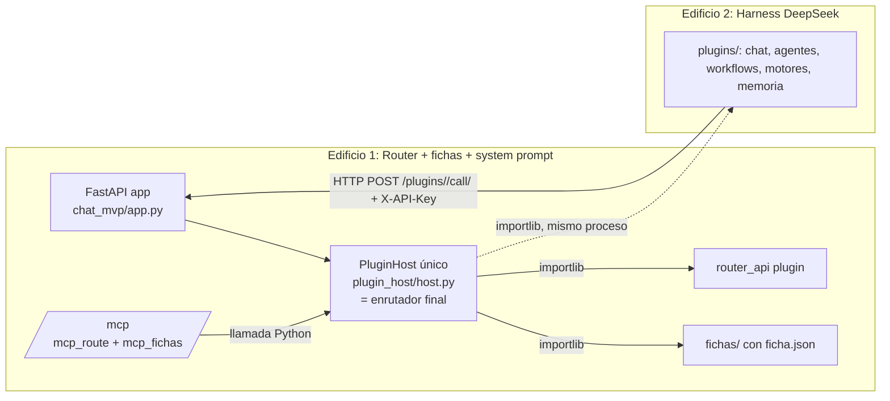

# Información de investigación de programación router

> Raíz Router (Grupo 1). Archivo base de información de la investigación del router mínimo. Contenido previo conservado: "Raíz de trabajo nueva del router mínimo. Aquí irá la investigación y la arquitectura. No tocar fuera de esta raíz."
>
> Autor: Grok Bot (Grupo 1). Fecha: 2026-10-21 (America/Bogota, UTC-5). Modo: solo lectura sobre todo el repo salvo este archivo. No se ejecutaron pruebas, ni deploy, ni se tocó Hugging Face.
>
> **Aviso de método:** el shell del entorno de trabajo falló durante la sesión ("Command failed to spawn"), así que la lectura se hizo con la API de GitHub y `raw.githubusercontent.com`. Por eso las referencias van por **archivo + función**; los números de línea quedan como **NO VERIFICADO** salvo que se indique. Ningún dato de este documento está inventado: lo que no se pudo comprobar se marca así.

---

## 1 Resumen ejecutivo

- El Router (Edificio 1) vive en `router/` y arranca con `router/boot.sh` → `router/boot_run.py` → `uvicorn public_chat_app:app` (puerto 7860). La app FastAPI real es `router/integration/chat_mvp/app.py`.
- **El PluginHost único existe** (`router/integration/plugin_host/host.py`, singleton `get_host()`), con su superficie HTTP `POST /plugins/{plugin_id}/call/{action}` en `router/integration/plugin_host/api.py`. Es el *enrutador final* / bus de plugins y debe quedar estable.
- **MCP** existe: `POST /mcp?key=` (`mcp_route.py`) + ampliación `listar_fichas`/`chat`/`resultado` (`mcp_fichas.py`), que ya llama **en proceso** a `get_host().call(...)` (sin HTTP a sí mismo).
- Hallazgos principales (todos con evidencia en código, ninguno validado en ejecución):
  1. **P0 seguridad:** la acción `env_keys` / `provider_keys` de `router/router_api/plugin.py` devuelve claves de proveedores en claro a quien llame `POST /plugins/router_api/call/...` con `X-API-Key`.
  2. **P1 seguridad:** la clave MCP viaja en query string y se compara con `!=` (no tiempo constante); no se valida `Origin` (la especificación MCP 2025-03-26 dice MUST).
  3. **P1 despliegue:** `autopull.py` ignora fallos de `git pull --ff-only` (no registra salida) y no existe endpoint que exponga el HEAD activo; solo se imprime `REPO_COMMIT` al arrancar (`boot.sh`). El código usa `/tmp/repo`, no `/data/repo`.
  4. **P1 concurrencia:** cada `call()` del host ocupa un hilo del pool de anyio (ruta `def`) **más** un hilo daemon; los hilos colgados no se pueden matar (limitado por `MAX_INFLIGHT=8` por plugin).
  5. **P2 coherencia:** docstring de `mcp_fichas.py` dice "Llama por HTTP al propio Router" pero el código llama en proceso (corregido en código, documentación desfasada). `red/http_plugins.py` tiene por defecto `http://127.0.0.1:7860` (riesgo de HTTP interno si se usa dentro del Edificio 1).
  6. **P2:** `app.py` intenta montar `omniroute_proxy`, que **no existe** en el árbol (falla silenciosa por diseño).
- Propuestas: solo cambios mínimos, ninguno toca PluginHost, enchufe, fichas ni infra (ver §28-§29 y matriz de compatibilidad).

## 2 Identificación del repositorio y commit investigado

| Campo | Valor |
|---|---|
| Repositorio | `maxbry123-commits/router-universal-router-inteligente-` |
| Rama | `reorganizacion` |
| HEAD al iniciar | `b5bf36d485eba946919af7233fca5a7651e53d07` ("Agregar t705 y t708 a INSTRUCCIONES_ANTONIO.md", 2026-10-21 19:58 UTC-5) |
| HEAD antes de escribir | `00dcb850dbcbc0163709c35cc059ac3d5abdc850` ("Agrega t709, t712/t713 (roles fijos)", 2026-10-21 20:17 UTC-5) |
| Diferencia entre ambos | 1 archivo: `INSTRUCCIONES_ANTONIO.md` (+2 líneas). `router/` no cambió → la investigación aplica a `00dcb850`. |
| Árbol `router/` | tree `801561659f4666fc99ae17d3115d31bf85adb67c` |
| README previo | blob `c043a78079760532a894747d55d98dd4b9f4987c` (147 bytes, contenido conservado arriba) |

## 3 Alcance del Grupo 1

- Según `INSTRUCCIONES_ANTONIO.md` t704/t708/t712-t713: Grupo 1 = router; resultados en `raiz_router/`; README "Información de investigación de programación router".
- Según `SKILL_ORQUESTADOR.md`: "Router mínimo: cómputo, almacenamiento, transporte (MCP/HTTP) y control de la SDK. Lo demás va a plugins con el enchufe universal".
- Fuera de alcance: estudio profundo de fichas y system prompt (Grupo 2). Aquí solo se estudian **las interfaces** del router hacia ellos.
- Prohibido: tocar Hugging Face, dataset, infra, variables, plugins, fichas; ejecutar pruebas o deploy.

## 4 Arquitectura obligatoria



Reglas: entre edificios solo HTTP `POST /plugins/<id>/call/<accion>` con `X-API-Key`; dentro del Edificio 1, llamadas Python. Un solo PluginHost, un solo enrutador final, sin tercer edificio.

**Observación verificada:** hoy el PluginHost carga **también** `plugins/` (Edificio 2) por `importlib` en el mismo proceso (`PluginHost.__init__`, `plugins_dir` = `RIU_PLUGINS_DIR` o `<raíz>/plugins`). Es decir, físicamente ambos edificios corren en un proceso; la frontera HTTP es la que usa el Edificio 2 para llamar al 1 (`router_api`). Esto es el estado actual, no una propuesta; no se propone cambiarlo.

## 5 Árbol real del Router

Nivel superior de `router/` (verificado con la API de GitHub):

```
router/
├── access_key.py            # clave única de acceso
├── adapters/github_public.py
├── api/index.py
├── autopull.py              # git pull --ff-only + os.execv
├── banco/                   # vault / secret_bank (protegido)
├── boot.sh, boot_run.py     # arranque
├── cognitive_control_plane/
├── componentes_api/storage.js
├── domain/schemas/enchufe_v2.py
├── enchufe/                 # validator_v2.py + docs y .py del Enchufe Universal v2
├── engine/resilience.py
├── fables_enchufe/          # ficha.json + plugin.py
├── gateway/                 # fastapi_app.py, hf_chat_mvp/
├── integration/
│   ├── chat_mvp/            # app.py, router.py, mcp_route.py, mcp_fichas.py, providers.py, resilience.py, ...
│   ├── huggingface/         # api_key_auth.py, fastapi_gateway.py, keystore_auth.py, ...
│   ├── plugin_host/         # host.py, api.py, __init__.py
│   ├── connectivity_runtime.py, hf_control_api.py, hf_worker_pool.py, verify_runtime_connectivity.py
├── mcp_puente_github.py     # servidor MCP original (tools GitHub)
├── public_chat_app.py       # entrada ASGI real (middleware ChatAccess + autopull)
├── red/                     # http_plugins.py, conectores.py, enchufe_gate.py, ...
├── requirements.txt
├── riu_kernel.py
├── router_api/              # plugin puerta HTTP del Edificio 1
├── scripts/, security/, tests/, thinking-modes/, tools/, verifier/
```

**No existe `Dockerfile`** en la raíz del repo ni en `router/` en esta rama (verificado en el listado de nivel superior). El Dockerfile del Space no está en GitHub: **NO VERIFICADO**.

## 6 Inventario de archivos y funciones

ARCHIVO → FUNCIÓN → RESPONSABILIDAD → DEPENDENCIAS → ESTADO. Líneas: NO VERIFICADO (ver aviso de método).

| Archivo | Función / símbolo | Responsabilidad | Dependencias | Estado |
|---|---|---|---|---|
| `router/boot.sh` | script | `REPO_COMMIT=$(git -C /tmp/repo rev-parse HEAD)`, PYTHONPATH, exec `boot_run.py` | git, bash | IMPLEMENTADO |
| `router/boot_run.py` | módulo | `riu_kernel.hydrate()`, copia vault, `bridge.unlock(...)`, `uvicorn.run("public_chat_app:app", port=7860, timeout_keep_alive=120)` | riu_kernel, vault_bridge, uvicorn | IMPLEMENTADO |
| `router/public_chat_app.py` | `ChatAccess.__call__`, `_limitado`, `_ip` | middleware: rate-limit por IP, sube limitador anyio a 100, inyecta `X-API-Key` del servidor en rutas "públicas"; arranca autopull | access_key, anyio, autopull | IMPLEMENTADO |
| `router/autopull.py` | `start`, `_git` | hilo daemon: cada 60 s `git pull --ff-only`; si cambia HEAD, `os.execv` | git, subprocess | PARCIAL (sin log de fallo de pull) |
| `router/access_key.py` | `access_key()` | primera var no vacía de `RIU_API_KEY`, `RIU_PUBLIC_CHAT_KEY`, `RIU_MCP_KEY`, `RIU_ROUTER_API_KEY` | os.environ | IMPLEMENTADO |
| `integration/chat_mvp/app.py` | `app`, startups | monta routers: plugin_host, chat, vault, jobs, route, openai, ui_bridge, omniroute, memoria, mcp, hf_control, gateway | muchos | IMPLEMENTADO / omniroute AUSENTE |
| `integration/plugin_host/host.py` | `PluginHost`, `call`, `_call`, `reload`, `sync`, `set_enabled`, `health`, `get_host`, `set_host` | registro + arnés único de plugins | importlib, threading, validator_v2 | IMPLEMENTADO |
| `integration/plugin_host/api.py` | `build_plugin_router`, `call_plugin`, `chat_gate` | HTTP `/plugins`, `/plugins/sync`, `/plugins/{id}/enable|disable`, `/plugins/{id}/call/{action}`, `/control/reload-policies` | host, `chat_mvp.router._auth` | IMPLEMENTADO |
| `integration/chat_mvp/mcp_route.py` | `build_mcp_router`, `mcp_http`, `_mod` | puerta MCP JSON-RPC por HTTP, `to_thread` | mcp_puente_github.py | IMPLEMENTADO |
| `integration/chat_mvp/mcp_fichas.py` | `instalar`, `_Ampliado.procesar_peticion`, `ejecutar`, `_llamar` | añade tools `listar_fichas`, `chat`, `resultado` → `get_host().call('fichas_qwen', ...)` | host | IMPLEMENTADO (docstring LEGADO) |
| `router/mcp_puente_github.py` | `procesar_peticion`, `procesar_respuesta`, `TOOLS` | servidor MCP original (tools GitHub) | GitHub API | NO VERIFICADO (no leído completo) |
| `integration/chat_mvp/providers.py` | `PROVIDERS`, `chat`, `env_keys`, `_http`, `chat_timeout`, `ATTEMPT_DEADLINE` | clientes OpenAI-compatibles (stdlib) | vault_hook, urllib | IMPLEMENTADO |
| `integration/chat_mvp/providers.json` | datos | registro alterno de proveedores (nvidia, openai, hf, groq, deepseek, moonshot, minimax) | — | DUPLICADO parcial con `PROVIDERS` |
| `integration/huggingface/api_key_auth.py` | `authenticate_api_key` | valida claves con `hmac.compare_digest` | keystore_auth, access_key | IMPLEMENTADO |
| `router/router_api/plugin.py` | `handle`, `_chat`, `_mem_op` | puerta del Edificio 1 para el Edificio 2 (memoria, providers, vault, chat) | chat_mvp.* | IMPLEMENTADO (riesgo P0) |
| `router/router_api/ficha.json` | ficha | `entry_point router.router_api.plugin:handle`, `timeout_ms 120000` | — | IMPLEMENTADO |
| `router/red/http_plugins.py` | `llamar` | cliente HTTP entre edificios, base por defecto `http://127.0.0.1:${PORT:-7860}` | urllib | IMPLEMENTADO (uso NO VERIFICADO) |
| `router/enchufe/validator_v2.py` | `validar` | contrato de ficha (Fables) cargado por el host | — | IMPLEMENTADO |
| `router/domain/schemas/enchufe_v2.py` | esquema | esquema Enchufe v2 | — | NO VERIFICADO (no leído) |
| `router/enchufe/*universal_plugin_bus_v2_integrated.py`, `*ficha_contract_v2.py` | código fuente de referencia | bus/contrato v2 (nombres con emojis) | — | NO VERIFICADO si se importa; host no lo importa |
| `integration/chat_mvp/omniroute_proxy.py` | — | importado por app.py | — | AUSENTE |

### Matriz de componentes

| ID | Componente | Archivo real | Función | Estado | Evidencia | GAP | Prioridad |
|---|---|---|---|---|---|---|---|
| C01 | Entrada ASGI | `router/public_chat_app.py` | `ChatAccess` | IMPLEMENTADO | lectura de código | — | P3 |
| C02 | App FastAPI | `integration/chat_mvp/app.py` | `app` | IMPLEMENTADO | lectura | R07 | P2 |
| C03 | PluginHost / enrutador final | `integration/plugin_host/host.py` | `get_host`, `call` | IMPLEMENTADO | lectura | R02,R06 | P1 |
| C04 | HTTP de plugins | `integration/plugin_host/api.py` | `call_plugin` | IMPLEMENTADO | lectura | R04 | P2 |
| C05 | MCP base | `integration/chat_mvp/mcp_route.py` | `mcp_http` | IMPLEMENTADO | lectura | R01 | P1 |
| C06 | MCP fichas | `integration/chat_mvp/mcp_fichas.py` | `_llamar` | IMPLEMENTADO | lectura | R04 | P2 |
| C07 | Proveedores LLM | `integration/chat_mvp/providers.py` | `chat` | IMPLEMENTADO | lectura | R06 | P2 |
| C08 | Puerta Edificio 1 | `router/router_api/plugin.py` | `handle` | IMPLEMENTADO | lectura | SEG-01 | P0 |
| C09 | Autoupdate | `router/autopull.py` | `start` | PARCIAL | lectura | R03,R10 | P1 |
| C10 | Validador Enchufe v2 | `router/enchufe/validator_v2.py` | `validar` | IMPLEMENTADO | usado por `repo_validator()` | R08 | P3 |
| C11 | Cliente HTTP edificios | `router/red/http_plugins.py` | `llamar` | IMPLEMENTADO | lectura | R04 | P2 |
| C12 | OmniRoute | `integration/chat_mvp/omniroute_proxy.py` | — | AUSENTE | no está en el árbol | R07 | P3 |
| C13 | Dockerfile | — | — | AUSENTE en GitHub | listado raíz | R10 | P2 |

## 7 Arquitectura actual del núcleo

```mermaid
sequenceDiagram
  participant SH as boot.sh
  participant BR as boot_run.py
  participant UV as uvicorn
  participant PA as public_chat_app (ChatAccess)
  participant APP as chat_mvp/app.py
  SH->>SH: REPO_COMMIT=git -C /tmp/repo rev-parse HEAD
  SH->>BR: exec python boot_run.py
  BR->>BR: riu_kernel.hydrate(); vault unlock
  BR->>UV: uvicorn.run(public_chat_app:app, 0.0.0.0:7860)
  UV->>PA: import → importa integration.chat_mvp.app
  PA->>APP: app.add_middleware(ChatAccess)
  PA->>PA: autopull.start() (hilo daemon)
  APP->>APP: chat_gate_dependencies() → get_host() (lee plugins/ una vez)
  APP->>APP: include_router(...) en orden; cada montaje opcional en try/except
```

Ciclo de vida: dos `@app.on_event("startup")` (`_storage_autosync`, `_seed_wordflow_fleet`). `on_event` está deprecado en FastAPI a favor de `lifespan` (no se propone migrar: no es necesario para el router mínimo).

## 8 Enrutador final

- **Dónde:** `PluginHost.call()` en `integration/plugin_host/host.py` (singleton `get_host()`, protegido con `_host_lock`).
- **Qué hace `call()`** (verificado en código): nunca lanza; valida existencia, ficha válida, `enabled`, `placeholder`, acción en `allowed_actions`, payload dict; aplica timeout `min(timeout ficha o argumento, 120 s)` (por defecto 5 s); limita `MAX_INFLIGHT = 8` llamadas por plugin; ejecuta `fn(action, payload)` en un `threading.Thread(daemon=True)` y espera con `Event.wait(limit)`; rechaza entry points `async` ("entrypoint async no soportado"). Respuestas: `{"status":"ok","result","ms"}`, `{"status":"degraded","reason"}`, `{"status":"off"}`.
- **Debe quedar estable:** ninguna propuesta de este documento modifica `call()`.

## 9 Enchufe Universal v2

- Contrato aplicado por el host en dos capas: (1) `check_v1()` – bloque `plugin_host` con `schema: plugin_host/v1`, `id` = carpeta, `enabled_default` bool, `version` semver, `categoria` ∈ {pipeline, transversal, acelerador}, `ejecucion.entry_point` con prefijo permitido (`integration.`, `plugins.`, `router.`, `fichas.`), `allowed_actions` lista, `health_action` dentro de `allowed_actions`; (2) `validar()` de `router/enchufe/validator_v2.py` cargado por ruta.
- Firma de entry point: `handle(action: str, payload: dict) -> Any` (síncrona). Evidencia: `_call()` → `resolve_entrypoint(entry)(action, dict(payload))` y `router_api/plugin.py: handle(action, payload)`.
- **Especificación provisional derivada (marcada PROVISIONAL, no documentada formalmente):**

```json
{
  "plugin_host": {"schema": "plugin_host/v1", "id": "<carpeta>", "enabled_default": true, "health_action": "status", "nota_roja": ""},
  "version": "0.1.0",
  "categoria": "pipeline",
  "ejecucion": {"entry_point": "plugins.<id>.plugin:handle", "allowed_actions": ["status"]},
  "seguridad": {"limites": {"timeout_ms": 5000}}
}
```

## 10 PluginHost existente

| Aspecto | Evidencia (función) |
|---|---|
| Ubicación | `integration/plugin_host/host.py` |
| Inicialización | `get_host()` crea `PluginHost()` una vez; `chat_gate_dependencies()` lo fuerza al importar la app |
| Descubrimiento | `reload()`: carpetas de `plugins/` + carpetas con `ficha.json` en `fichas/` y `router/` (hermanas de `plugins_dir`) |
| Registro | `_load_one()` → `check_v1` + `validator_v2`; límite `RIU_MAX_PLUGINS` (50) |
| Descubrimiento de acciones | `allowed_actions` de la ficha; `GET /plugins` lista con `health` |
| Llamada | `call()` (§8); HTTP `POST /plugins/{id}/call/{action}` |
| Autenticación | `Depends(_auth)` de `chat_mvp.router` (X-API-Key o Bearer, según docstring de api.py; `_auth` NO VERIFICADO línea a línea) |
| Estado on/off | `plugins_state.json` (`RIU_PLUGINS_STATE` o `RIU_DATA_DIR`/`/data`/`./riu_data`) escrito atómico con `os.replace` |
| Resincronizar | `POST /plugins/sync`; autosync opcional `RIU_PLUGINS_AUTOSYNC_S` |

Segundo PluginHost: **no se encontró** otro host en `router/` (se revisaron `integration/`, `red/`, `router_api/`). `enchufe/*universal_plugin_bus_v2_integrated.py` es un bus de referencia; si alguna vez se importara como host paralelo sería DUPLICADO — hoy no hay evidencia de que se importe (NO VERIFICADO).

## 11 Comunicación interna Python

- `mcp_fichas._llamar()` → `get_host().call(plugin, accion, payload)`: **correcto** (llamada local, sin HTTP). Comentario en código: "Llamada local al PluginHost del mismo proceso (sin HTTP a si mismo)".
- `router_api/plugin.py` importa `integration.chat_mvp.{providers,memoria_loader,vault_hook}` directamente: correcto dentro del Edificio 1.
- Riesgo: `red/http_plugins.llamar()` apunta por defecto a `127.0.0.1:7860`. Si código del Edificio 1 lo usa, sería HTTP del router a sí mismo (prohibido). Consumidores reales: **NO VERIFICADO** (búsqueda de código en rama no default no disponible).

## 12 Comunicación HTTP entre edificios

- Ruta: `POST /plugins/{plugin_id}/call/{action}` (cuerpo JSON opcional = payload) → `get_host().call(...)`. Ruta `def` (se ejecuta en el threadpool de anyio).
- Cliente: `red/http_plugins.llamar(plugin, accion, payload, timeout=120.0)` con `X-API-Key` desde `RIU_API_KEY`/`RIU_PUBLIC_CHAT_KEY`; mapea `HTTPError` a `{"error":"HTTP <code>: <reason>","status":"degraded"}`.
- Middleware `ChatAccess`: para rutas que empiezan por `/plugins/puente_chat/call/`, `/plugins/fichas/call/`, `/plugins/fichas_qwen/call/`, `/memoria/`, `/espacio/`, `/chat/` y `GET /plugins`, **sustituye** la cabecera `X-API-Key` por la del servidor. Efecto verificado en código: esas rutas quedan accesibles sin clave (diseño "passwordless chat"). `router_api` **no** está en la lista pública.

Ejemplo (placeholders falsos):

```bash
curl -X POST "https://ROUTER.example/plugins/router_api/call/status" \
  -H "X-API-Key: FAKE_KEY_123" -H "Content-Type: application/json" -d '{}'
```

## 13 Integración MCP

| Pieza | Evidencia |
|---|---|
| Transporte | Streamable HTTP, solo respuesta JSON (no SSE); `GET /mcp` devuelve info, no SSE (la spec permite 405; aquí devuelve 200 JSON) |
| Auth | `?key=` comparado con `!=` contra `RIU_MCP_KEY` o `RIU_PUBLIC_CHAT_KEY`; error JSON-RPC `-32001` 401 |
| JSON inválido | `-32700` 400 |
| Lotes | lista de peticiones; solo notificaciones → 202 |
| Concurrencia | `await asyncio.to_thread(...)` procesa el lote **secuencialmente** en un hilo |
| tools/list | `_Ampliado`: `TOOLS` originales + `listar_fichas`, `chat`, `resultado` |
| tools/call nuevas | `ACCION = {listar_fichas: fichas, chat: chat_async, resultado: resultado}` sobre plugin `fichas_qwen`; faltantes → `FALTA: <campo>` con `isError: true` |
| Cabecera | `MCP-Protocol-Version: 2025-03-26` |

Clases de error (propuesta de taxonomía, sin cambiar códigos existentes): MCP (`-32700`, `-32001`, `isError`), router (`degraded` "fallo interno del host"), plugin (`degraded` con `reason` de la excepción), red (`HTTP <code>` / `OSError` en http_plugins), proveedor (`ProviderError PROVIDER_ERROR:<status>`), timeout (`timeout: sin respuesta en N s` del host; `SIN_RESPUESTA_EN_<n>S` en router_api).

## 14 Integración con fichas

Solo interfaz (el estudio de fichas es del Grupo 2): el router ve una ficha como carpeta con `ficha.json` en `fichas/` (o `plugins/`), cargada por el mismo PluginHost; MCP usa el plugin `fichas_qwen` con acciones `fichas`, `chat_async`, `resultado`; el middleware hace públicas `/plugins/fichas/call/` y `/plugins/fichas_qwen/call/`. No se propone ningún cambio en fichas.

## 15 Integración de proveedores LLM

- `providers.PROVIDERS` (verificado): `nvidia` (principal, `https://integrate.api.nvidia.com/v1`), `hf` (`https://router.huggingface.co/v1`), `groq`, `openai`, `deepseek` (`https://api.deepseek.com/v1`), `moonshot`, `minimax`, `local`.
- **Qwen y GLM no tienen entrada propia** en `PROVIDERS`; si se usan, sería como modelos servidos por otro proveedor (p. ej. NVIDIA/HF). Qué modelos concretos están configurados: NO VERIFICADO (no se leyó `policies.json`/`model_registry.json` en detalle).
- Cliente: `urllib` síncrono, `CHAT_TIMEOUT = 90 s`, recortado por `ATTEMPT_DEADLINE` (contextvar). Claves enmascaradas en errores (`detail.replace(key, "***")`).
- Duplicado: `providers.json` repite URLs/env de `PROVIDERS` → DUPLICADO parcial (no se propone borrar sin trazabilidad Grok+Sol, regla de poda).

## 16 FastAPI y asyncio

- Rutas `def` (p. ej. `call_plugin`, `list_plugins`) → threadpool de anyio (documentado en FastAPI: "run in an external threadpool"). `ChatAccess` sube el limitador a 100 tokens en la primera petición HTTP.
- `/mcp` es `async def` y delega con `asyncio.to_thread` → no bloquea el loop.
- `chat_gate` es `async def` y solo toma un `RLock` corto: riesgo bajo de bloqueo del loop.
- Riesgo de loop bloqueado: cualquier ruta `async def` que llame `get_host().call()` **sin** `to_thread` bloquearía el loop hasta el timeout del plugin. En lo leído no se encontró ese caso; el resto de rutas: NO VERIFICADO.

## 17 Concurrencia, timeouts y bloqueos

```mermaid
flowchart TB
  A[Cliente HTTP / MCP] --> B[hilo anyio (máx 100)]
  B --> C[PluginHost.call: Event.wait(limit ≤120 s)]
  C --> D[hilo daemon plugin-<id> (máx 8 en curso por plugin)]
  D --> E[providers._http urlopen timeout ≤90 s]
```

Cadena de timeouts verificada: `http_plugins` 120 s → host `min(ficha, 120 s)` (router_api: 120 s) → `router_api._chat` tope por defecto 60 s → `providers.chat_timeout()` ≤ 90 s recortado al deadline. Riesgo: un cliente con 120 s y un host con 120 s empatan; el cliente puede cortar antes de recibir el `degraded` del host (sin evidencia de ejecución).

Carrera potencial: en `_call()` el chequeo `self._inflight.get(...) >= MAX_INFLIGHT` y el incremento — si están fuera del `with self._lock` — no son atómicos. La indentación exacta no pudo verificarse con las herramientas disponibles: **NO VERIFICADO**.

## 18 Seguridad y credenciales

| ID | Hallazgo | Evidencia | Estado |
|---|---|---|---|
| SEG-01 | `router_api` acciones `env_keys`/`provider_keys` devuelven claves en claro | `handle()` → `{"claves": list(providers.env_keys(...))}` | CONFIRMADO (código) |
| SEG-02 | Clave MCP en query y comparación `!=` | `mcp_http`: `request.query_params.get('key') != key_esperada` | CONFIRMADO |
| SEG-03 | Sin validación de `Origin` en `/mcp` (spec 2025-03-26: MUST) | `mcp_http` no lee `Origin` | CONFIRMADO |
| SEG-04 | Rate-limit usa `X-Forwarded-For` sin confianza de proxy | `_ip()` | CONFIRMADO (impacto depende del proxy, NO VERIFICADO) |
| SEG-05 | CORS por defecto `*` | `RIU_CORS_ORIGINS` default `"*"`, `allow_credentials=False` | CONFIRMADO (riesgo bajo) |
| SEG-06 | Rutas públicas con clave inyectada (`/memoria/`, `/plugins/fichas*/call/`) | `ChatAccess` | CONFIRMADO, por diseño |
| OK | `api_key_auth` usa `hmac.compare_digest`; proveedores enmascaran clave | código | IMPLEMENTADO |

No se leyó ni imprimió ningún secreto. Ejemplos con placeholders (`FAKE_KEY_123`).

## 19 Rendimiento y optimización

No hay métricas verificables en el repo para este documento (no se ejecutó nada). Método propuesto antes/después:

1. Mismo HEAD, mismo hardware, plugin de prueba `status` (sin red).
2. Medir p50/p95 de `POST /plugins/router_api/call/status` con 1, 10, 50 concurrentes (p. ej. `hey`/`wrk` o script `httpx` async), 60 s cada uno; registrar `ms` que devuelve el host.
3. Repetir tras el cambio. Criterio: p95 no empeora >10 %. Nada se declara PASS sin el log adjunto.

## 20 Gestión de errores y recuperación

- Host: nunca lanza; todo error → `degraded` con `reason` (truncado a 200/300 chars). Montajes opcionales de la app en `try/except` con `logging.warning`.
- `boot_run.py`: fallo de vault → imprime `GAP vault unlock: <tipo>` y continúa.
- `autopull`: excepción → `AUTOPULL_EXCEPCION`; **pero** un `git pull` que devuelve código ≠ 0 no lanza (`subprocess.run` sin `check`) y su salida se descarta → fallo silencioso.
- MCP `tools/call` de fichas: excepción → `ERROR: <msg>` + `isError: true`.

## 21 Actualización desde GitHub

- `boot.sh` usa `/tmp/repo` (no `/data/repo`) y registra `REPO_COMMIT` solo al arrancar.
- `autopull.start()` (llamado desde `public_chat_app.py`): `ROUTER_AUTOPULL != "0"`; repo = `git rev-parse --show-toplevel` del directorio del archivo; cada 60 s `git pull --ff-only`; si cambia HEAD → `os.execv(sys.executable, [sys.executable] + sys.argv)`.
- Verificar código activo == HEAD (método read-only propuesto): exponer el HEAD leído al arranque en `/health` o en la respuesta de `router_api status` (ver §29 P-04) y comparar con `GET https://api.github.com/repos/<repo>/commits/reorganizacion`.
- Cómo se clona `/tmp/repo` y quién ejecuta `boot.sh` (Dockerfile del Space): NO VERIFICADO; no se toca HF.

## 22 Investigación de sistemas reales

| Sistema | URL verificada | Licencia (verificada API GitHub) | Commit observado (2026-10-21) | Qué aporta |
|---|---|---|---|---|
| LiteLLM | https://github.com/BerriAI/litellm | MIT fuera de `enterprise/` (licencia propia allí) | `b6f91a221b6b9df6f8a89ec6f8264ac87d63ff5d` | proxy OpenAI-compatible, fallbacks, cooldown de claves |
| RouteLLM | https://github.com/lm-sys/RouteLLM | Apache-2.0 | `0b64fdafe049e596a3f5657c219329f24af24198` (último commit 2024-08) | enrutado por coste/calidad entre 2 modelos |
| Portkey Gateway | https://github.com/Portkey-AI/gateway | MIT | `669825cbe89ee51569918b8f78a9db486fd69dd4` | gateway TS, retries/fallback declarativos |
| MCP Python SDK | https://github.com/modelcontextprotocol/python-sdk | MIT | `2af9e3089ac66b35c1550c500aae86a82efb1e17` | servidor MCP de referencia (Streamable HTTP) |
| Spec MCP transports | https://modelcontextprotocol.io/specification/2025-03-26/basic/transports | — | versión 2025-03-26 | reglas de `Origin`, 202, SSE/JSON |
| FastAPI async | https://fastapi.tiangolo.com/async/ | — | — | `def` → threadpool; `async def` no debe bloquear |

Archivos clave internos de esos proyectos: NO VERIFICADO (no se clonaron). OpenRouter y gateways MCP de terceros: no investigados en esta sesión (SIN EVIDENCIA).

## 23 Código reutilizable y licencias

- **Reutilizar ideas, no código** (para no añadir dependencias ni infra): patrón "cooldown de clave tras 429" (LiteLLM), validación de `Origin` (spec MCP). Cualquier copia literal de MIT/Apache-2.0 exige conservar aviso de copyright/licencia; de `enterprise/` de LiteLLM no copiar nada.
- No se propone instalar LiteLLM/Portkey: serían un segundo enrutador (RECHAZADA en la matriz).

## 24 Comparativa de implementaciones

| Criterio | Router actual | LiteLLM | Portkey | RouteLLM |
|---|---|---|---|---|
| Lenguaje | Python stdlib + FastAPI | Python | TypeScript | Python |
| Bus de plugins | PluginHost propio | callbacks | plugins/guardrails | no |
| Fallback de claves | sí (`env_keys` + bucle) | sí | sí | no |
| MCP | sí (JSON, sin SSE) | NO VERIFICADO | NO VERIFICADO | no |
| Encaja en 2 edificios sin infra extra | sí | no (proceso aparte) | no | no |

## 25 Gaps confirmados

Estados: CONFIRMADO / CORREGIDO EN CÓDIGO / VALIDADO EN EJECUCIÓN / PARCIAL / NO REPRODUCIDO / SIN EVIDENCIA SUFICIENTE.

| GAP | Hipótesis | Estado | Evidencia |
|---|---|---|---|
| GAP-R01 | Timeouts MCP | PARCIAL | `/mcp` usa `to_thread`; lote secuencial; `chat` es asíncrono (`chat_async` + `resultado`); timeout de `fichas_qwen` NO VERIFICADO |
| GAP-R02 | Event loop bloqueado | SIN EVIDENCIA SUFICIENTE | rutas leídas usan `def` o `to_thread` |
| GAP-R03 | Código actualizado no reflejado | CONFIRMADO (parcial) | `autopull` descarta fallo de `git pull`; sin log |
| GAP-R04 | Llamadas internas vs HTTP inconsistentes | CORREGIDO EN CÓDIGO (docstring desfasado) | `mcp_fichas._llamar` local; docstring dice HTTP; `http_plugins` default 127.0.0.1 |
| GAP-R05 | Propagación de errores | PARCIAL | `_llamar` reduce todo a `{error,status}`; se pierde `ms` y la clase de error |
| GAP-R06 | Timeouts encadenados | CONFIRMADO | 120 s cliente = 120 s host; 90 s proveedor; 60 s tope |
| GAP-R07 | Responsabilidades duplicadas | PARCIAL | `providers.json` vs `PROVIDERS`; import a `omniroute_proxy` inexistente |
| GAP-R08 | Contrato de plugin incompatible | PARCIAL | host rechaza entry points `async`; contrato v2 completo NO VERIFICADO |
| GAP-R09 | Faltan pruebas de concurrencia | SIN EVIDENCIA SUFICIENTE | hay `tests/` y `test_router_api.py`; no se leyeron ni ejecutaron |
| GAP-R10 | HEAD remoto vs código activo | CONFIRMADO (sin verificación) | solo `REPO_COMMIT` en stdout al boot; sin endpoint |

Fichas de problema confirmado:

**SEG-01** — PROBLEMA: exposición de claves. EVIDENCIA: `router_api/plugin.py::handle` acciones `env_keys`, `provider_keys`. CAUSA: la puerta devuelve los valores en lugar de usarlos. SOLUCIÓN MÍNIMA: P-01. UBICACIÓN: `router/router_api/plugin.py`. DEPENDENCIAS: consumidores en `plugins/` (NO VERIFICADO cuáles). COMPATIBILIDAD: rompe a quien lea `claves`; mitigable devolviendo `n` y huella. PRUEBAS: T-01. RIESGOS: plugins que dependan de la clave. ESTADO: CONFIRMADO.

**SEG-02/03** — PROBLEMA: auth MCP débil. EVIDENCIA: `mcp_route.mcp_http`. CAUSA: comparación simple, sin Origin. SOLUCIÓN: P-02. UBICACIÓN: `integration/chat_mvp/mcp_route.py`. COMPATIBILIDAD: total (misma clave, mismo `?key=`; Origin solo se valida si viene y hay lista). PRUEBAS: T-02. RIESGOS: bajo. ESTADO: CONFIRMADO.

**GAP-R03/R10** — PROBLEMA: no se sabe si el proceso corre HEAD. EVIDENCIA: `autopull._git` descarta returncode/stderr. SOLUCIÓN: P-03 + P-04. UBICACIÓN: `router/autopull.py`, `router/router_api/plugin.py`. COMPATIBILIDAD: total. PRUEBAS: T-03, T-04. RIESGOS: bajo. ESTADO: CONFIRMADO.

**GAP-R06** — PROBLEMA: timeouts empatados. EVIDENCIA: `http_plugins.llamar(timeout=120.0)` y `router_api/ficha.json timeout_ms 120000`. SOLUCIÓN: P-05. UBICACIÓN: `router/red/http_plugins.py`. COMPATIBILIDAD: total. PRUEBAS: T-05. ESTADO: CONFIRMADO.

## 26 Componentes incompletos

- `autopull.py` (sin observabilidad de fallos).
- MCP sin SSE ni `Mcp-Session-Id` (aceptable: la spec permite JSON simple).
- `mcp_fichas.py` docstring desfasado.
- `providers.json` vs `PROVIDERS` (fuente doble).

## 27 Componentes realmente faltantes

- `integration/chat_mvp/omniroute_proxy.py` (importado, no existe).
- Dockerfile del despliegue en GitHub (no está en la rama).
- Endpoint/acción que reporte el HEAD activo.
- Pruebas de concurrencia del host (no verificadas como existentes).

## 28 Propuestas de programación mínima

| ID | Propuesta | Archivo | Tamaño |
|---|---|---|---|
| P-01 | `env_keys`/`provider_keys` devuelven solo cuántas hay + huella sha256[:8] | `router/router_api/plugin.py` | ~6 líneas |
| P-02 | `hmac.compare_digest` + `Origin` opcional por `RIU_MCP_ORIGINS` | `integration/chat_mvp/mcp_route.py` | ~8 líneas |
| P-03 | `autopull` registra returncode/stderr del pull | `router/autopull.py` | ~5 líneas |
| P-04 | `router_api status` devuelve `head_activo` leído al importar | `router/router_api/plugin.py` | ~6 líneas |
| P-05 | timeout del cliente = host + margen (125 s) | `router/red/http_plugins.py` | 1 línea |
| P-06 | corregir docstring de `mcp_fichas.py` | `integration/chat_mvp/mcp_fichas.py` | 1 línea |

### Matriz de compatibilidad arquitectónica

| Propuesta | Respeta dos edificios | Mantiene PluginHost único | Evita HTTP interno | No invade fichas | Cambio mínimo | Resultado |
|---|---|---|---|---|---|---|
| P-01 | sí | sí | sí | sí | sí | ACEPTADA |
| P-02 | sí | sí | sí | sí | sí | ACEPTADA |
| P-03 | sí | sí | sí | sí | sí | ACEPTADA |
| P-04 | sí | sí | sí | sí | sí | ACEPTADA |
| P-05 | sí | sí | sí | sí | sí | ACEPTADA |
| P-06 | sí | sí | sí | sí | sí | ACEPTADA |
| Instalar LiteLLM/Portkey como gateway | no (tercer componente) | no | sí | sí | no | RECHAZADA |
| Hacer `call()` async / reescribir host | sí | no (rediseño) | sí | sí | no | RECHAZADA |
| `mcp_fichas` vía `http_plugins` a 127.0.0.1 | sí | sí | no | sí | sí | RECHAZADA |
| Cola de agentes/planner en router | no | sí | sí | no | no | RECHAZADA |

## 29 Código y diffs propuestos

> **PROPUESTA — NO APLICADA.** Ningún diff de esta sección se ha aplicado al repo. Requieren el método por archivo (Sol → centinelas → validadores) antes de subir.

**P-01** `router/router_api/plugin.py` (PROPUESTA)

```diff
+import hashlib
+
+def _resumen(claves):
+    return {"n": len(claves), "huellas": [hashlib.sha256(c.encode()).hexdigest()[:8] for c in claves]}
@@ def handle(action, payload):
         if action == "env_keys":
             from integration.chat_mvp import providers
-            return {"status": "ok", "claves": list(providers.env_keys(str(p.get("proveedor") or "")))}
+            return {"status": "ok", **_resumen(list(providers.env_keys(str(p.get("proveedor") or ""))))}
         if action == "provider_keys":
             from integration.chat_mvp import vault_hook
-            return {"status": "ok", "claves": list(vault_hook.provider_keys(str(p.get("proveedor") or "")))}
+            return {"status": "ok", **_resumen(list(vault_hook.provider_keys(str(p.get("proveedor") or ""))))}
```

La acción `chat` sigue usando las claves dentro del Edificio 1, sin exponerlas.

**P-02** `integration/chat_mvp/mcp_route.py` (PROPUESTA)

```diff
+import hmac
@@ async def mcp_http(request: Request):
         key_esperada = os.getenv('RIU_MCP_KEY') or os.getenv('RIU_PUBLIC_CHAT_KEY')
-        if not key_esperada or request.query_params.get('key') != key_esperada:
+        recibida = request.query_params.get('key') or ''
+        if not key_esperada or not hmac.compare_digest(recibida, key_esperada):
             return JSONResponse({...igual...}, status_code=401)
+        permitidos = [o.strip() for o in os.getenv('RIU_MCP_ORIGINS', '').split(',') if o.strip()]
+        origen = request.headers.get('origin')
+        if origen and permitidos and origen not in permitidos:
+            return JSONResponse({'jsonrpc': '2.0', 'id': None, 'error': {'code': -32001, 'message': 'origin no permitido'}}, status_code=403)
```

Sin `RIU_MCP_ORIGINS` el comportamiento no cambia (no se modifican variables de entorno en esta investigación).

**P-03** `router/autopull.py` (PROPUESTA)

```diff
-            _git(repo, "pull", "--ff-only")
+            r = subprocess.run(["git", "-C", repo, "pull", "--ff-only"], capture_output=True, text=True, timeout=120)
+            if r.returncode != 0:
+                print("AUTOPULL_FALLO rc=%d %s" % (r.returncode, (r.stderr or "")[:200]), file=sys.stderr, flush=True)
```

**P-04** `router/router_api/plugin.py` (PROPUESTA)

```diff
+import os, subprocess
+def _head():
+    try:
+        return subprocess.run(["git", "-C", os.path.dirname(os.path.abspath(__file__)), "rev-parse", "HEAD"],
+                              capture_output=True, text=True, timeout=5).stdout.strip() or None
+    except Exception:
+        return None
+HEAD_ACTIVO = _head()  # se lee una vez al importar: es el código que corre
@@
         if action == "status":
-            return {"status": "ok", "acciones": [...]}
+            return {"status": "ok", "acciones": [...], "head_activo": HEAD_ACTIVO}
```

**P-05** `router/red/http_plugins.py` (PROPUESTA): `def llamar(..., timeout: float = 125.0)` para que el host (≤120 s) responda `degraded` antes de que corte el cliente.

**P-06** `integration/chat_mvp/mcp_fichas.py` (PROPUESTA): cambiar la última línea del docstring por "Llama en proceso a get_host().call() (sin HTTP a sí mismo)".

## 30 Pruebas unitarias e integración

Ninguna ejecutada (prohibido en esta tarea). Estado de todas: **PENDIENTE** (ni PASS ni FAIL).

| ID | Objetivo | Precondiciones | Método | Esperado | PASS/FAIL | Evidencia |
|---|---|---|---|---|---|---|
| T-01 | P-01 no expone claves | vault con 2 claves falsas `FAKE_A`, `FAKE_B` | `handle("env_keys", {"proveedor":"groq"})` con `monkeypatch` | `n==2`, sin `FAKE_` en la salida | PENDIENTE | — |
| T-02 | MCP auth | `RIU_MCP_KEY=FAKE_KEY_123` | `TestClient.post('/mcp?key=mal')` / bien / Origin malo con `RIU_MCP_ORIGINS` | 401 / 200 / 403 | PENDIENTE | — |
| T-03 | autopull registra fallo | repo temporal con divergencia | ejecutar `loop` una vez | línea `AUTOPULL_FALLO` en stderr | PENDIENTE | — |
| T-04 | HEAD activo | repo temporal | `handle("status", {})` | `head_activo` == `git rev-parse HEAD` | PENDIENTE | — |
| T-05 | orden de timeouts | plugin falso que duerme 121 s, ficha 120000 ms | `llamar(...)` | recibe `degraded` con `timeout:` (no `TimeoutError`) | PENDIENTE | — |
| T-06 | host no lanza | `set_host(PluginHost(tmpdir))` con ficha rota | `call()` | `status=degraded` | PENDIENTE | — |

## 31 Pruebas de concurrencia

| ID | Objetivo | Método | Esperado | Estado |
|---|---|---|---|---|
| TC-01 | `MAX_INFLIGHT` | 20 hilos llaman un plugin falso que duerme 2 s | ≤8 `ok` simultáneos, resto `degraded "ya hay 8 llamadas"` | PENDIENTE |
| TC-02 | carrera `_inflight` | 200 llamadas concurrentes a plugin instantáneo; contador final | `_inflight[id] == 0` | PENDIENTE |
| TC-03 | loop no bloqueado | `/mcp` con `resultado` lento + `GET /mcp` en paralelo | `GET /mcp` responde < 100 ms | PENDIENTE |
| TC-04 | agotamiento threadpool | 120 peticiones a ruta `def` lenta | sin deadlock; latencia medida | PENDIENTE |

## 32 Verificación cruzada

| Afirmación | Fuente 1 | Fuente 2 | Resultado |
|---|---|---|---|
| Ruta `/plugins/{id}/call/{action}` | `plugin_host/api.py` | `docs/ARQUITECTURA.md` ("Solo HTTP: POST /plugins/ /call/") | coincide |
| Host carga desde `plugins/` | `host.py::PluginHost.__init__` | `docs/ARQUITECTURA.md` | coincide (doc no menciona `fichas/` ni `router/`, el código sí) |
| MCP local sin HTTP | código `mcp_fichas._llamar` | docstring de `mcp_fichas.py` | **no coincide** (GAP-R04) |
| HEAD investigado | API commits | get_commit `00dcb85` solo cambia `INSTRUCCIONES_ANTONIO.md` | coincide |
| Licencias | API `/license` | texto LICENSE decodificado | coincide |

## 33 Riesgos de regresión

- P-01: plugins del Edificio 2 que lean `claves` dejarían de funcionar → antes de aplicar, listar consumidores (búsqueda `env_keys`/`provider_keys` en `plugins/`).
- P-02: clientes MCP que envíen `Origin` no listado → solo si se define `RIU_MCP_ORIGINS`.
- P-03/P-04: ninguno funcional; P-04 añade un `git rev-parse` al importar (≤5 s timeout).
- P-05: ninguno; solo alarga 5 s el peor caso del cliente.

## 34 Orden de implementación recomendado


Cada paso: un archivo por salida (método SKILL), centinelas PASA, validadores, subir, borrar de la PC.

## 35 Checklist de aceptación

- [x] Un solo archivo modificado: `raiz_router/README.md`.
- [x] Título exacto y 37 secciones en orden.
- [x] Matriz de componentes y matriz de compatibilidad incluidas.
- [x] Sin secretos; placeholders falsos.
- [x] Sin cambios en router, fichas, plugins, infra, HF.
- [ ] Pruebas T-01..T-06 y TC-01..TC-04 ejecutadas con evidencia (pendiente, fuera de alcance).
- [ ] Números de línea verificados con clon local (pendiente: shell no disponible).

## 36 Fuentes y URLs verificadas

Todas abiertas con éxito el 2026-10-21 (UTC-5):

- https://raw.githubusercontent.com/maxbry123-commits/router-universal-router-inteligente-/reorganizacion/INSTRUCCIONES_ANTONIO.md
- https://raw.githubusercontent.com/maxbry123-commits/router-universal-router-inteligente-/reorganizacion/SKILL_ORQUESTADOR.md
- https://raw.githubusercontent.com/maxbry123-commits/router-universal-router-inteligente-/reorganizacion/docs/ARQUITECTURA.md
- https://raw.githubusercontent.com/maxbry123-commits/router-universal-router-inteligente-/reorganizacion/router/boot.sh (y `boot_run.py`, `autopull.py`, `public_chat_app.py`, `access_key.py`, `requirements.txt`)
- https://raw.githubusercontent.com/maxbry123-commits/router-universal-router-inteligente-/reorganizacion/router/integration/plugin_host/host.py (y `api.py`)
- https://raw.githubusercontent.com/maxbry123-commits/router-universal-router-inteligente-/reorganizacion/router/integration/chat_mvp/app.py (y `mcp_route.py`, `mcp_fichas.py`, `providers.py`, `providers.json`)
- https://raw.githubusercontent.com/maxbry123-commits/router-universal-router-inteligente-/reorganizacion/router/integration/huggingface/api_key_auth.py
- https://raw.githubusercontent.com/maxbry123-commits/router-universal-router-inteligente-/reorganizacion/router/router_api/plugin.py (y `ficha.json`)
- https://raw.githubusercontent.com/maxbry123-commits/router-universal-router-inteligente-/reorganizacion/router/red/http_plugins.py
- https://github.com/BerriAI/litellm
- https://github.com/lm-sys/RouteLLM
- https://github.com/Portkey-AI/gateway
- https://github.com/modelcontextprotocol/python-sdk
- https://modelcontextprotocol.io/specification/2025-03-26/basic/transports
- https://fastapi.tiangolo.com/async/

## 37 Conclusiones y prioridades

- **P0:** SEG-01 (claves en claro vía `router_api`). Aplicar P-01 tras confirmar consumidores.
- **P1:** SEG-02/03 (MCP), GAP-R03/R10 (visibilidad de HEAD y fallos de pull), GAP-R06 (timeouts).
- **P2:** GAP-R04 docstring, GAP-R07 duplicados (`providers.json`, `omniroute_proxy` ausente), Dockerfile fuera de GitHub.
- **P3:** migrar `on_event` a `lifespan` (no necesario), SSE MCP (no necesario).
- El núcleo ya cumple la arquitectura: un PluginHost, llamadas Python dentro del Edificio 1, HTTP con `X-API-Key` entre edificios. No hace falta nada nuevo grande; solo los 6 cambios mínimos.

### Centinelas (antes del push)

| Centinela | Veredicto | Motivo |
|---|---|---|
| Centinela 1 | PASA | Salida = README "Información de investigación de programación router" en `raiz_router/` (t704, t708, t712/t713). No toca HF (t563, t650). Fuente de verdad en GitHub (t640, t671). |
| Centinela 2 | PASA (con observación) | Mismas instrucciones releídas en HEAD `00dcb85`. Observación: t640 dice que Sol prepara el prompt; este agente no puede verificar que el prompt recibido venga de «🔎 investigación Grupo 1». |
