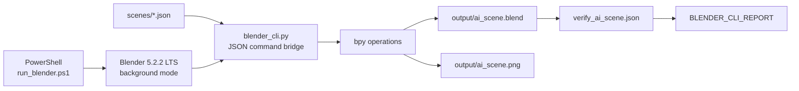

# Blender JSON Scene Pipeline: AI Neural Core


Proyecto reproducible para construir y renderizar una escena 3D desde operaciones JSON. Incluye un puente de comandos para Blender, una escena de ejemplo, un smoke test y una validación estructural del `.blend` generado.

## Qué hace

- Traduce una lista JSON de operaciones a llamadas reales de `bpy`.
- Ejecuta Blender 5.2.2 LTS sin interfaz gráfica.
- Construye una red neuronal 3D, un núcleo emisivo, anillos, conexiones, luces, cámara y suelo.
- Renderiza con EEVEE a 1600 × 900.
- Guarda el render PNG y la escena `.blend`.
- Comprueba motor, resolución, cámara, objetos y compositor mediante aserciones.

La escena final ejecuta 34 operaciones. La última prueba de reproducibilidad terminó con 0 errores y renderizó en 1,3 s en la máquina de desarrollo; el tiempo depende del hardware.

## De cero al primer render

Desde PowerShell, en la raíz del repositorio:

```powershell
.\scripts\install_blender.ps1
.\tools\blender_tool\run_blender.ps1 -Commands .\scenes\smoke_test.json
```

El segundo comando debe terminar con una línea equivalente a:

```text
BLENDER_CLI_REPORT {"ok": true, "ops_total": 11, "errors": [], ...}
```

El resultado se guarda en `output/smoke_test.png`.

## Cómo funciona

`run_blender.ps1` localiza la instalación portable y abre Blender en modo `--background --factory-startup`. Blender ejecuta `blender_cli.py`, que lee el JSON, aplica cada operación con su API Python y emite un informe final legible por máquina.



No hay un servidor MCP, servicio web, paquete Node ni dependencia Python externa. Qwen 3.8-27B y Cline formaron parte del proceso original de creación, pero no son dependencias de ejecución.

## Arquitectura

Los componentes que forman el flujo reproducible son:

- `tools/blender_tool/run_blender.ps1`: lanzador de Windows.
- `tools/blender_tool/blender_cli.py`: puente reutilizable y catálogo de operaciones.
- `scenes/*.json`: descripción declarativa de escenas y verificaciones.
- Blender y su Python integrado: ejecución de `bpy`, render y guardado.
- `BLENDER_CLI_REPORT`: contrato de salida para saber si hubo errores.

La arquitectura y sus límites están explicados en [docs/architecture.md](docs/architecture.md).

## Requisitos

- Windows x64.
- PowerShell 7.6.5 o compatible; esa es la versión con la que se probaron los comandos.
- Conexión a Internet para la instalación inicial de Blender.
- Aproximadamente 1,4 GB libres durante la descarga y extracción; el ZIP temporal se elimina al terminar.

No es necesario instalar Python. Blender 5.2.2 LTS incluye Python 3.13.13 y todas las APIs usadas por el proyecto.

## Instalación desde cero

```powershell
git clone https://github.com/RicardoBertran/blender-json-scene-pipeline.git
cd blender-json-scene-pipeline
.\scripts\install_blender.ps1
```

El instalador descarga el ZIP portable oficial de Blender 5.2.2, comprueba su SHA-256 y lo extrae en `tools/blender/`. Esa carpeta y el archivo descargado están excluidos de Git.

Para usar otra ubicación:

```powershell
.\scripts\install_blender.ps1 -Destination 'D:\Apps\BlenderPortable'
.\tools\blender_tool\run_blender.ps1 `
  -BlenderRoot 'D:\Apps\BlenderPortable' `
  -Commands .\scenes\smoke_test.json
```

## Primer smoke test

```powershell
.\tools\blender_tool\run_blender.ps1 -Commands .\scenes\smoke_test.json
```

Genera un cubo emisivo, una luz, una cámara, una conexión segmentada y dos archivos en `output/`. Su propósito es comprobar el recorrido completo antes de construir la escena principal.

## Creación de la escena

```powershell
.\tools\blender_tool\run_blender.ps1 -Commands .\scenes\ai_scene.json
```

La descripción contiene 34 operaciones. Entre ellas hay materiales, una red neuronal de cinco capas, transformaciones, geometría, iluminación, cámara, compositor, render y guardado.

Las rutas de salida usan `${PROJECT_ROOT}`. El lanzador la sustituye por la raíz actual del proyecto, por lo que el repositorio no depende de `E:\Qwen-Blender-Agent-Test`.

## Render

La operación `set_render` selecciona `BLENDER_EEVEE`, 1600 × 900 y escala `1.0`. El puente convierte esa escala a `resolution_percentage = 100`.

La salida es:

- `output/ai_scene.png`: render generado.
- `output/ai_scene.blend`: escena editable y resultado técnico de referencia.

El `.blend` de referencia se conserva en Git porque ocupa menos de 300 KB. Los renders generados se ignoran; la imagen final de documentación vive en `docs/images/ai-neural-core.png`.

## Validación

Después de generar la escena:

```powershell
.\tools\blender_tool\run_blender.ps1 -Commands .\scenes\verify_ai_scene.json
```

La validación es de solo lectura y falla si no encuentra EEVEE, 1600 × 900 al 100 %, la cámara `Cam`, 160 objetos o el enlace del nodo Glare a la salida del compositor. También exige `Fog Glow`, umbral `0.4` y fuerza `5.0`.

Resultado esperado:

```text
AI_SCENE_VERIFY engine=BLENDER_EEVEE resolution=1600x900 objects=160 glare=Fog_Glow threshold=0.4 strength=5.0 output_link=ok
BLENDER_CLI_REPORT {"ok": true, "ops_total": 2, "errors": [], ...}
```

## Resultado

La escena de referencia contiene 160 objetos y combina una pared de nodos conectados con un núcleo emisivo, dos halos metálicos, corrientes de datos, luces cian/magenta y un suelo reflectante oscuro.

El flujo final probado es:

```text
JSON -> blender_cli.py -> bpy -> EEVEE -> PNG + BLEND -> validación
```

## Problemas encontrados

Los fallos relevantes dejaron cambios concretos en los archivos actuales:

- Las primitivas válidas para el generador dinámico son `ico_sphere` y `uv_sphere`, no `ico` ni `sphere`.
- Blender 5.2 usa un grupo de nodos de composición asignado a `Scene.compositing_node_group`. El nodo Glare se conecta tanto a la salida del grupo como al Viewer.
- El tipo aceptado por la entrada del nodo es `Fog Glow`.
- El identificador válido del motor en esta versión es `BLENDER_EEVEE`, no `BLENDER_EEVEE_NEXT`.
- `scale` es un factor de 0 a 1 en el JSON. El puente lo multiplica por 100; por eso el valor correcto es `1.0`, no `100`.
- Una prueba A/B conectó Glare primero a la salida guardada y luego solo al Viewer. Los dos PNG difirieron en 2303 de 2304 píxeles, confirmando que el glow debía estar conectado a `Group Output` para aparecer en el archivo.

Los archivos `_probe*` son investigaciones del API y validaciones de bajo nivel. Se conservan localmente, pero `.gitignore` evita confundirlos con el resultado reproducible. El intento `demo_flythrough.json` no forma parte del proyecto publicado: falló por una inserción de keyframes sobre un `Vector` y porque FFMPEG no estaba disponible como formato de imagen en esa configuración.

## Troubleshooting

Consulta [docs/troubleshooting.md](docs/troubleshooting.md) para errores de instalación, rutas, primitivas, motor, escala, compositor y lectura de `BLENDER_CLI_REPORT`.

## Estructura del proyecto

```text
.
|-- README.md
|-- docs/
|   |-- architecture.md
|   |-- getting-started.md
|   |-- scene-format.md
|   |-- troubleshooting.md
|   `-- images/
|       `-- ai-neural-core.png
|-- output/
|   `-- ai_scene.blend
|-- scenes/
|   |-- ai_scene.json
|   |-- smoke_test.json
|   `-- verify_ai_scene.json
|-- scripts/
|   `-- install_blender.ps1
`-- tools/
    `-- blender_tool/
        |-- blender_cli.py
        `-- run_blender.ps1
```

## Licencia

Publicado bajo la [licencia MIT](LICENSE).


