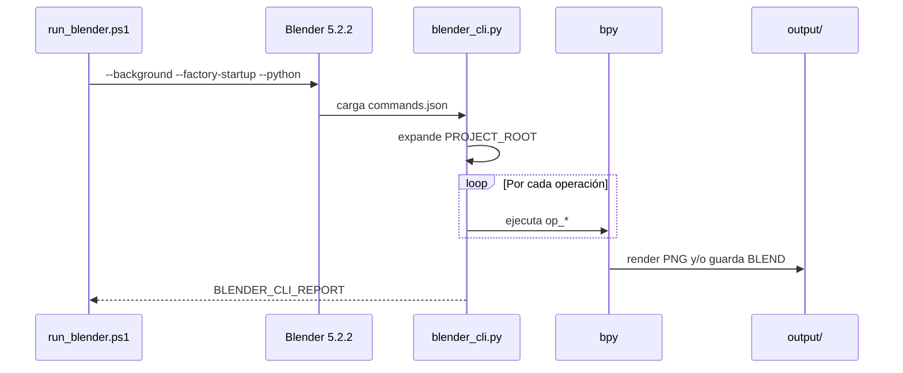

# Arquitectura

## Resumen

El proyecto es un ejecutor local de operaciones JSON para Blender. No contiene MCP, servidor HTTP, sockets, extensión de Cline ni proceso residente.



## Responsabilidades

### `run_blender.ps1`

- Localiza `blender.exe` debajo de `-BlenderRoot`.
- Resuelve la ruta del archivo JSON.
- Expone `BLENDER_JSON_PROJECT_ROOT` al proceso hijo.
- Activa el arranque limpio de Blender.
- Conserva el código de salida del proceso.

### `blender_cli.py`

- Carga una lista de operaciones o un objeto con `meta` y `ops`.
- Sustituye `${PROJECT_ROOT}` recursivamente en valores de texto.
- Despacha cada nombre de operación a una función concreta.
- Continúa tras errores de una operación para poder informar de todos ellos.
- Devuelve código 0 solo cuando `errors` está vacío.

### Archivos de escena

`smoke_test.json` valida el recorrido mínimo. `ai_scene.json` es la definición reproducible del resultado. `verify_ai_scene.json` abre el `.blend` y ejecuta aserciones de solo lectura.

## Dependencias reales

La única dependencia de ejecución es Blender 5.2.2 LTS. Se usan módulos incluidos con Blender: `bpy`, `mathutils`, `json`, `fnmatch`, `math`, `os`, `sys` y `time`.

Python 3.13.13 es parte de la distribución portable. Qwen y Cline explican el origen del experimento, pero no participan en el flujo reproducible.

## Frontera de confianza

La operación `exec` ejecuta Python dentro de Blender. Es necesaria para las transformaciones y el compositor que no tienen todavía una operación declarativa propia, pero no es un sandbox. Solo deben ejecutarse JSON de confianza.

## Salida y control de errores

Cada ejecución termina con:

```text
BLENDER_CLI_REPORT <json>
```

Campos:

- `ok`: verdadero si ninguna operación falló.
- `ops_total`: cantidad de operaciones leídas.
- `errors`: operación y excepción de cada fallo.
- `blender`: versión informada por Blender.
- `scene`: nombre de la escena activa al terminar.

